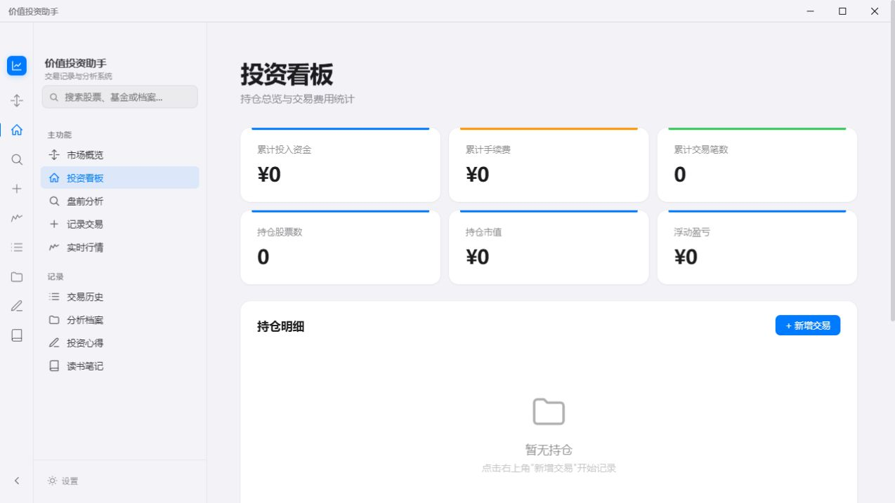
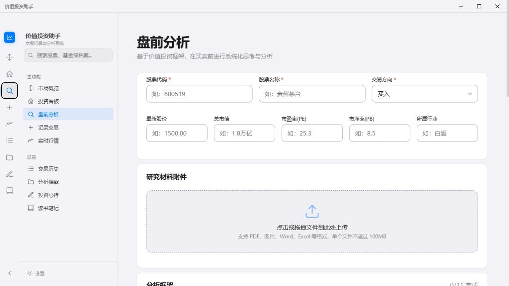
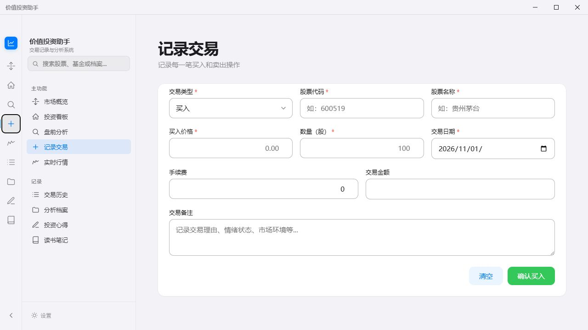

# 价值投资助手

一款本地优先的桌面投资记录与研究工具，用统一工作区管理交易、持仓、盘前分析、研究档案、投资心得和读书笔记。

> 本项目仅用于个人研究、记录与学习，不构成投资建议，也不保证行情数据的完整性或实时性。

## 为什么开发

投资决策容易被短期波动和零散信息牵着走。价值投资助手尝试把“交易发生了什么、当时为什么判断、后来如何验证”放进同一条可复盘的记录链中，让研究过程比结果本身更可追踪。

AI 在这里用于整理材料、发现遗漏和辅助形成分析框架，不替用户作出买卖决定。

## 主要功能

- **投资看板：**根据交易记录汇总持仓、成本、收益和资产分布。
- **交易与复盘：**记录买卖、费用和理由，保留完整交易历史。
- **盘前分析：**按价值投资框架整理公司、估值、风险和行动计划。
- **研究档案：**集中保存公司分析、附件和历史版本。
- **行情观察：**查看自选标的、主要市场与汇率信息。
- **知识沉淀：**管理投资心得和读书笔记。
- **AI 辅助：**用户自行配置 DeepSeek API Key 后，可对研究材料进行结构化分析。
- **数据迁移：**支持本地 JSON 导入、导出与文件夹备份。

## 界面预览

### 投资看板



### 盘前分析



### 交易记录



## 隐私与密钥

- 交易、持仓、研究档案和笔记默认保存在本机。
- 仓库和发布包不包含任何 API Key、OAuth 密钥、账户令牌或用户投资数据。
- DeepSeek API Key 由用户在应用设置中自行填写，并保存在应用本地存储中。
- 百度网盘 OAuth 凭据不随公开版本分发。开发者如需启用相关功能，应提供自己的 `BAIDU_APP_KEY` 与 `BAIDU_SECRET_KEY`，并优先采用服务端令牌交换。
- 只有用户主动运行 AI 分析时，所选内容和提示词才会发送给相应模型服务商。

详细说明见 [PRIVACY.md](PRIVACY.md)。

## 本地运行

```bash
npm install
npm start
```

代码检查：

```bash
npm run check
```

Windows 打包：

```bash
npm run build:win
```

## 数据来源

应用会访问公开行情接口获取市场参考数据。第三方接口可能调整、延迟或中断，使用前请以证券交易平台及上市公司正式披露为准。

## 许可证

本项目以“源代码可查看”的方式发布，用于作品展示、学习与非商业评估。未经书面许可，不得将代码或构建产物用于商业分发。详见 [LICENSE](LICENSE)。
